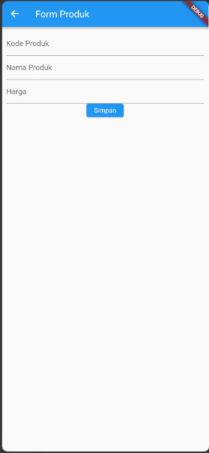
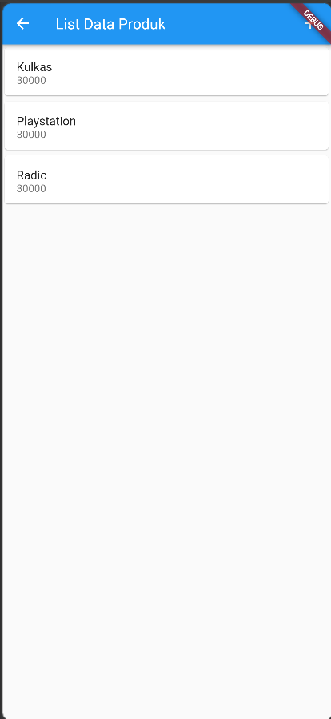
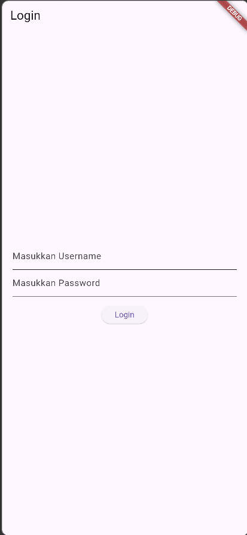
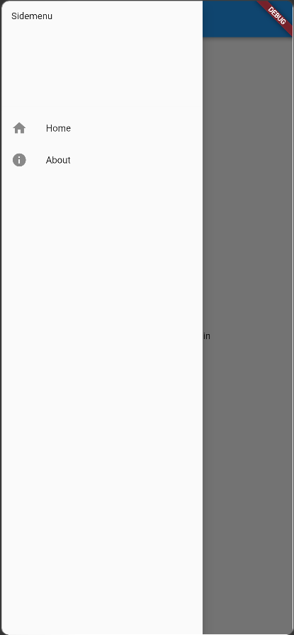
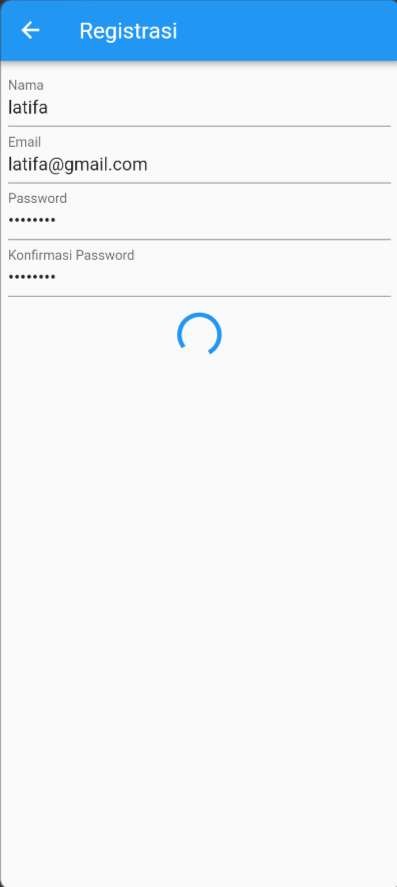
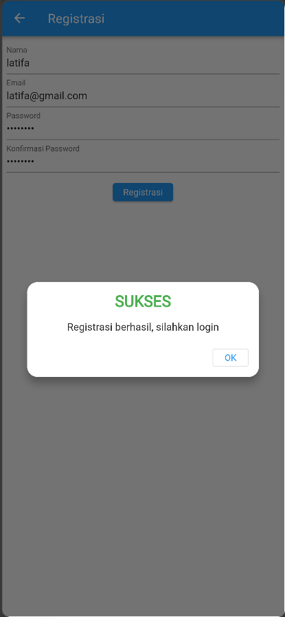
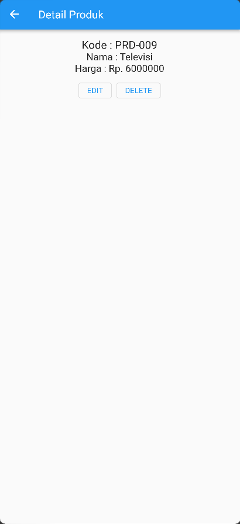
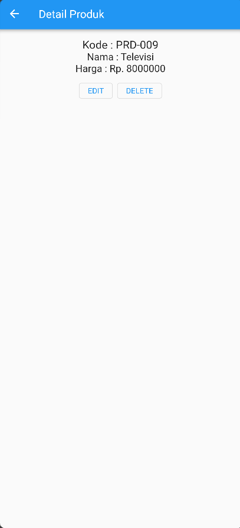
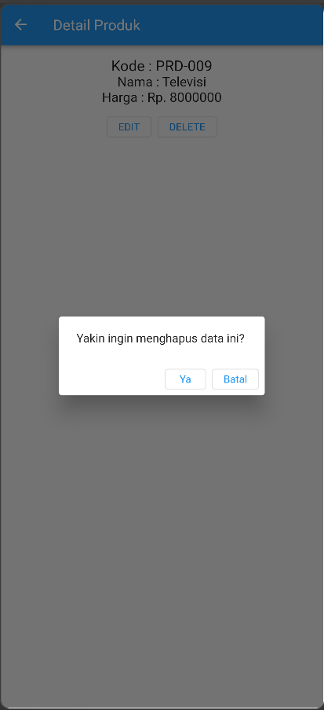
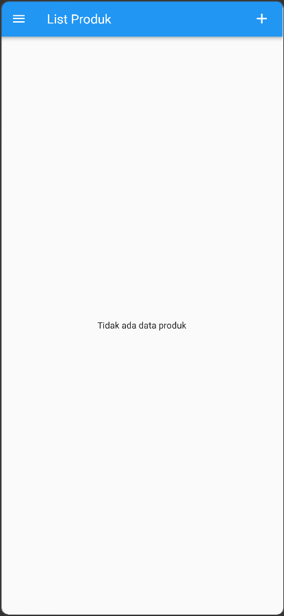

# Praktikum Pemrograman Mobile - Flutter (`H1D024099`)

Repository ini berisi hasil praktikum mata kuliah **Pemrograman Mobile** menggunakan framework **Flutter** dan backend **CodeIgniter 4 RESTful API** (Modul 2, Modul 3, hingga Modul 4).

---

## Identitas Mahasiswa

| Keterangan | Data |
| :--- | :--- |
| **Nama** | Latifanika Nurafwi |
| **NIM** | `H1D024099` |
| **Shift KRS** | H |
| **Shift Sekarang** | D |
| **Mata Kuliah** | Praktikum Pemrograman Mobile |
| **GitHub** | [LATIFANIKA-NURAFWI1](https://github.com/LATIFANIKA-NURAFWI1) |

---

## Modul 2: Widget Dasar, Form Input, Navigasi Halaman & ListView

Pada Modul 2 dipelajari pembuatan tampilan dasar menggunakan `StatelessWidget` dan `StatefulWidget`, tata letak `Column` dan `Row`, form input (`TextField`), pengiriman data antar halaman menggunakan `Navigator.push` + `MaterialPageRoute`, serta menampilkan daftar data menggunakan `ListView` dan `Card`.

### 1. Widget Dasar (`HelloWorld`, `ColumnWidget`, `RowWidget`)

- **Hello World** (`lib/hello_world.dart`): Menampilkan teks `"Hello World"` di tengah layar menggunakan widget `Center` dan `Text`.
- **Column Widget** (`lib/column_widget.dart`): Mengatur tata letak child widget secara vertikal (`Kolom 1` – `Kolom 4`).
- **Row Widget** (`lib/row_widget.dart`): Mengatur tata letak child widget secara horizontal (`Row 1` – `Row 4`).

| Hello World | Column Widget | Row Widget |
| :---: | :---: | :---: |
|  |  |  |

### 2. Form Produk, Detail Produk & List Data Produk

- **Form Produk** (`lib/ui/produk_form.dart`): Form input `Kode Produk`, `Nama Produk`, dan `Harga` yang mengirimkan data ke halaman detail saat tombol **Simpan** ditekan.
- **Detail Produk** (`lib/ui/produk_detail.dart`): Menampilkan detail informasi produk (`Kode Produk`, `Nama Produk`, dan `Harga Produk`) yang diterima melalui parameter constructor.
- **List Data Produk** (`lib/ui/produk_page.dart`): Menampilkan daftar produk dalam `ListView` dengan `Card` dan `ListTile`, tombol `+` di `AppBar` menuju `ProdukForm`, serta aksi klik item menuju `ProdukDetail`.

| Form Produk | Detail Produk | List Data Produk |
| :---: | :---: | :---: |
|  |  |  |

---

## Modul 3: Routes, Side Menu, Login & Local Storage

Pada Modul 3 ditambahkan sistem autentikasi login, penyimpanan data pengguna di local storage menggunakan package `shared_preferences`, navigasi berbasis **Named Routes** di `lib/main.dart`, serta menu samping (`Drawer`) di `lib/sidemenu.dart`.

- **Login Page** (`lib/login_page.dart`): Halaman awal aplikasi (`/`). Validasi login menggunakan `username: admin` dan `password: admin`, menampilkan `AlertDialog`, serta menyimpan username ke `SharedPreferences`.
- **Home Page** (`lib/home_page.dart`): Halaman utama (`/home`) yang membaca kembali `username` dari `SharedPreferences` pada `initState` dan menampilkannya (`Ini adalah halaman User admin`).
- **About Page** (`lib/about_page.dart`): Halaman informasi (`/about`) yang dapat diakses melalui Side Menu.
- **Side Menu** (`lib/sidemenu.dart`): `Drawer` berisi navigasi ke **Home** dan **About**.

| Login Page | Home Page | Side Menu |
| :---: | :---: | :---: |
|  |  |  |

---

## Modul 4: Operasi CRUD dengan RESTful API CodeIgniter 4 (Toko Kita)

Pada Modul 4, aplikasi dikembangkan menjadi aplikasi toko mobile bernama **`tokokita`** yang terhubung secara penuh ke backend **RESTful API CodeIgniter 4 (`toko-api`)** dan database **MySQL**. Fitur yang diimplementasikan mencakup registrasi pengguna, login dengan token autentikasi, penyimpanan token sesi via `SharedPreferences`, serta operasi CRUD (*Create, Read, Update, Delete*) data produk secara real-time.

### Arsitektur & Spesifikasi Teknis

1. **Backend RESTful API (CodeIgniter 4 & MySQL)**:
   - Database: `toko_api` (tabel: `member`, `member_token`, `produk`).
   - Format Respon Standar: `{"code": integer, "status": boolean, "data": mixed}`.
   - Endpoint:
     - `POST /registrasi`: Pendaftaran akun member baru.
     - `POST /login`: Autentikasi member dan pengembalian token autentikasi.
     - `GET /produk`: Mengambil seluruh daftar produk dari database.
     - `POST /produk`: Menambahkan produk baru ke database.
     - `GET /produk/{id}`: Menampilkan detail produk berdasarkan ID.
     - `PUT /produk/{id}`: Memperbarui data produk berdasarkan ID.
     - `DELETE /produk/{id}`: Menghapus data produk berdasarkan ID.

2. **Frontend Flutter (`tokokita`)**:
   - **BLoC / Service Pattern**: Pemisahan logika bisnis dan panggilan API (`lib/bloc/`).
   - **HTTP Client Helper (`lib/helpers/api.dart`)**: Mendukung method `GET`, `POST`, `PUT`, `DELETE` dengan header JSON & token bearer serta penanganan error (`AppException`).
   - **Session Management (`lib/helpers/user_info.dart`)**: Menyimpan `token` dan `userID` secara persisten menggunakan `shared_preferences`.
   - **Type-Casting Resilience**: Penanganan aman konversi tipe data MySQLi (misal `id` dan `harga` bertipe `String` di-parse ke `int`).
   - **Dialog Feedback**: Tampilan `SuccessDialog` dan `WarningDialog` untuk setiap aksi.

---

### Alur Fitur & Dokumentasi Screenshot Modul 4

#### 1. Registrasi Akun Member
Pengguna mendaftarkan akun baru dengan Nama, Email unik, Password (minimal 6 karakter), dan Konfirmasi Password. Jika valid dan berhasil, muncul notifikasi sukses dan pengguna diarahkan ke halaman login.

| Form Registrasi | Dialog Registrasi Sukses |
| :---: | :---: |
|  |  |

#### 2. Autentikasi Login & Sesi Pengguna
Pengguna melakukan login menggunakan email dan password yang terdaftar. Token autentikasi disimpan di `SharedPreferences` sehingga pengguna tetap dalam kondisi login saat aplikasi dibuka kembali. Pada menu drawer terdapat opsi **Logout** untuk menghapus sesi dan kembali ke halaman login.

| Form Login Toko Kita | Side Menu (Drawer Logout) |
| :---: | :---: |
|  |  |

#### 3. Read Data (List Produk)
Halaman utama menampilkan daftar produk dari API secara dinamis menggunakan `FutureBuilder`. Jika database masih kosong, ditampilkan indikator *"Tidak ada data produk"*. Ketika data sudah ditambahkan, daftar produk ditampilkan dalam bentuk `Card` dan `ListTile`.

| List Produk Awal (Kosong) | List Produk Terisi |
| :---: | :---: |
|  |  |

#### 4. Create Data (Tambah Produk)
Tombol `+` pada `AppBar` membuka halaman form tambah produk. Setelah field `Kode Produk`, `Nama Produk`, dan `Harga` diisi dan tombol **SIMPAN** ditekan, data dikirim ke API via `POST /produk` dan memunculkan dialog sukses.

| Form Tambah Produk | Dialog Tambah Sukses |
| :---: | :---: |
|  |  |

#### 5. Detail & Update Data (Ubah Produk)
Memilih item produk akan membuka halaman **Detail Produk** yang memuat informasi lengkap serta tombol **EDIT** dan **DELETE**. Menekan tombol **EDIT** membuka form ubah produk, dan data yang diperbarui akan disimpan ke API via `PUT /produk/{id}`.

| Detail Produk Awal | Dialog Ubah Sukses | Detail Produk Terupdate |
| :---: | :---: | :---: |
|  |  |  |

#### 6. Delete Data (Hapus Produk)
Menekan tombol **DELETE** pada detail produk memicu dialog konfirmasi *"Yakin ingin menghapus data ini?"*. Jika dipilih tombol **Ya**, data dihapus dari database via `DELETE /produk/{id}` dan halaman kembali ke daftar produk yang sudah ter-update.

| Dialog Konfirmasi Hapus | List Produk Setelah Dihapus |
| :---: | :---: |
|  |  |

---

### Struktur Folder Proyek

```text
flutter1/
├── lib/
│   ├── bloc/
│   │   ├── login_bloc.dart
│   │   ├── logout_bloc.dart
│   │   ├── produk_bloc.dart
│   │   └── registrasi_bloc.dart
│   ├── helpers/
│   │   ├── api.dart
│   │   ├── api_url.dart
│   │   ├── app_exception.dart
│   │   └── user_info.dart
│   ├── model/
│   │   ├── login.dart
│   │   ├── produk.dart
│   │   └── registrasi.dart
│   ├── ui/
│   │   ├── login_page.dart
│   │   ├── produk_detail.dart
│   │   ├── produk_form.dart
│   │   ├── produk_page.dart
│   │   └── registrasi_page.dart
│   ├── widget/
│   │   ├── success_dialog.dart
│   │   └── warning_dialog.dart
│   ├── about_page.dart
│   ├── column_widget.dart
│   ├── hello_world.dart
│   ├── home_page.dart
│   ├── login_page.dart
│   ├── main.dart
│   ├── row_widget.dart
│   └── sidemenu.dart
├── ss/
│   ├── 4detail.png
│   ├── 4detailbaru.png
│   ├── 4hapus.png
│   ├── 4konfirhapus.png
│   ├── 4list.png
│   ├── 4login2.png
│   ├── 4produk.png
│   ├── 4regist.png
│   ├── 4registsukses.png
│   ├── 4side.png
│   ├── 4tambah.png
│   ├── 4tambahsukses.png
│   ├── 4ubahsukses.png
│   ├── column.png
│   ├── dataproduk.png
│   ├── detail.png
│   ├── formproduk.png
│   ├── hello.png
│   ├── homepage.png
│   ├── login.png
│   ├── row.png
│   └── sidemenu.png
└── pubspec.yaml
```

---

## Cara Menjalankan Aplikasi

1. **Jalankan Web Server & Database**:
   - Pastikan Laragon atau XAMPP aktif dengan Apache & MySQL berjalan.
   - Pastikan proyek backend `toko-api` berada di `htdocs` (XAMPP) atau `www` (Laragon).
2. **Pasang Dependensi**:
   ```bash
   flutter pub get
   ```
3. **Jalankan Aplikasi Flutter**:
   - Untuk Browser Chrome:
     ```bash
     flutter run -d chrome
     ```
   - Untuk Android Emulator / Real Device:
     ```bash
     flutter run
     ```
     *(Catatan: `ApiUrl.baseUrl` otomatis mendeteksi platform Chrome / Android Emulator).*

## Pengujian & Analisis Kode

Jalankan pengujian statis dan unit test:
```bash
flutter analyze
flutter test
```
*Hasil analisis: `No issues found!`, semua widget test dan parsing model lulus 100%.*
