# Praktikum Pemrograman Mobile - Flutter (`H1D024099`)

Repository ini berisi hasil praktikum mata kuliah **Pemrograman Mobile** menggunakan framework **Flutter** dan backend **CodeIgniter 4 RESTful API** (Modul 2, Modul 3, Modul 4, hingga Modul 5).

---

## Identitas Mahasiswa

| Keterangan | Data |
| :--- | :--- |
| **Nama** | Latifanika Nurafwi |
| **NIM** | `H1D024099` |
| **Shift KRS** | H |
| **Shift Sekarang** | D |
| **Mata Kuliah** | Praktikum Pemrograman Mobile |
| **GitHub** | [LATIFANIKA-NURAFWI1](https://github.com/LATIFANIKA-NURAFWI1) |

---

## Modul 2: Widget Dasar, Form Input, Navigasi Halaman & ListView

Pada Modul 2 dipelajari pembuatan tampilan dasar menggunakan `StatelessWidget` dan `StatefulWidget`, tata letak `Column` dan `Row`, form input (`TextField`), pengiriman data antar halaman menggunakan `Navigator.push` + `MaterialPageRoute`, serta menampilkan daftar data menggunakan `ListView` dan `Card`.

### 1. Widget Dasar (`HelloWorld`, `ColumnWidget`, `RowWidget`)

- **Hello World** (`lib/hello_world.dart`): Menampilkan teks `"Hello World"` di tengah layar menggunakan widget `Center` dan `Text`.
- **Column Widget** (`lib/column_widget.dart`): Mengatur tata letak child widget secara vertikal (`Kolom 1` – `Kolom 4`).
- **Row Widget** (`lib/row_widget.dart`): Mengatur tata letak child widget secara horizontal (`Row 1` – `Row 4`).

| Hello World | Column Widget | Row Widget |
| :---: | :---: | :---: |
| 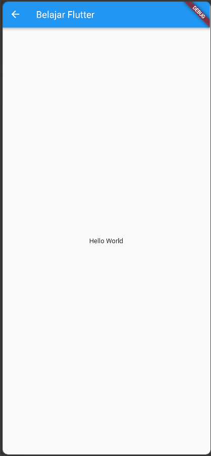 | 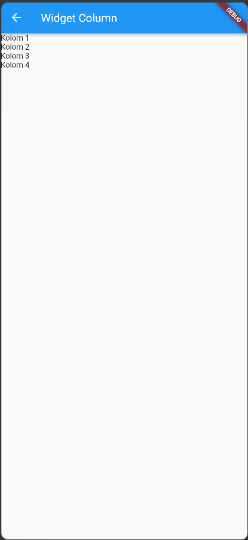 | 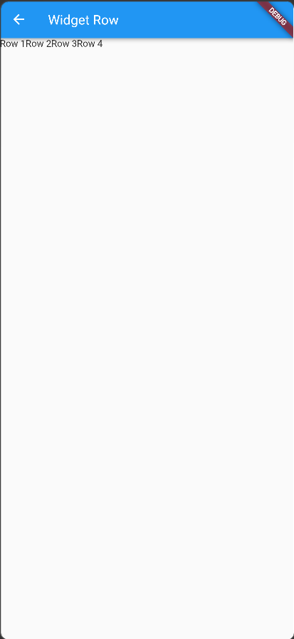 |

### 2. Form Produk, Detail Produk & List Data Produk

- **Form Produk** (`lib/ui/produk_form.dart`): Form input `Kode Produk`, `Nama Produk`, dan `Harga` yang mengirimkan data ke halaman detail saat tombol **Simpan** ditekan.
- **Detail Produk** (`lib/ui/produk_detail.dart`): Menampilkan detail informasi produk (`Kode Produk`, `Nama Produk`, dan `Harga Produk`) yang diterima melalui parameter constructor.
- **List Data Produk** (`lib/ui/produk_page.dart`): Menampilkan daftar produk dalam `ListView` dengan `Card` dan `ListTile`, tombol `+` di `AppBar` menuju `ProdukForm`, serta aksi klik item menuju `ProdukDetail`.

| Form Produk | Detail Produk | List Data Produk |
| :---: | :---: | :---: |
|  | 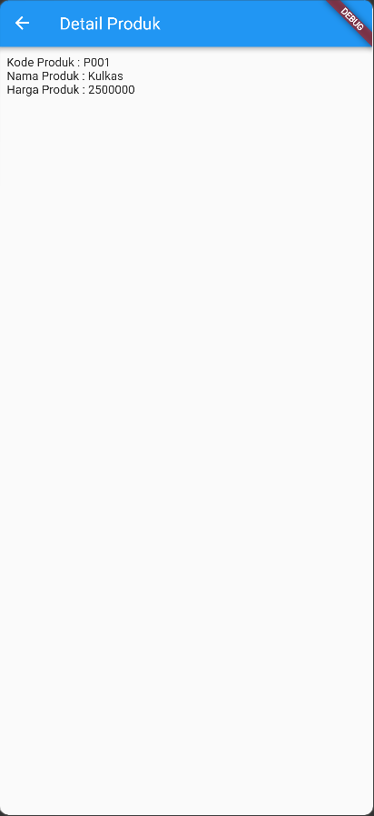 |  |

---

## Modul 3: Routes, Side Menu, Login & Local Storage

Pada Modul 3 ditambahkan sistem autentikasi login, penyimpanan data pengguna di local storage menggunakan package `shared_preferences`, navigasi berbasis **Named Routes** di `lib/main.dart`, serta menu samping (`Drawer`) di `lib/sidemenu.dart`.

- **Login Page** (`lib/login_page.dart`): Halaman awal aplikasi (`/`). Validasi login menggunakan `username: admin` dan `password: admin`, menampilkan `AlertDialog`, serta menyimpan username ke `SharedPreferences`.
- **Home Page** (`lib/home_page.dart`): Halaman utama (`/home`) yang membaca kembali `username` dari `SharedPreferences` pada `initState` dan menampilkannya (`Ini adalah halaman User admin`).
- **About Page** (`lib/about_page.dart`): Halaman informasi (`/about`) yang dapat diakses melalui Side Menu.
- **Side Menu** (`lib/sidemenu.dart`): `Drawer` berisi navigasi ke **Home** dan **About**.

| Login Page | Home Page | Side Menu |
| :---: | :---: | :---: |
|  |  |  |

---

## Modul 4: Operasi CRUD dengan RESTful API CodeIgniter 4 (Bagian 1)

Pada Modul 4 Bagian 1, dibangun pondasi backend RESTful API menggunakan framework **CodeIgniter 4** dan database **MySQL** (`toko-api`), serta inisialisasi model dan antarmuka statis pada aplikasi mobile **`tokokita`**.

1. **Pembuatan Database & Tabel**:
   - Database: `toko_api`
   - Tabel `member` (kolom: `id`, `nama`, `email`, `password`)
   - Tabel `member_token` (kolom: `id`, `member_id`, `auth_key`)
   - Tabel `produk` (kolom: `id`, `kode_produk`, `nama_produk`, `harga`)
2. **Backend Controller & Routing RESTful**:
   - `RestfulController`: Base controller yang menangani standarisasi respon JSON (`code`, `status`, `data`).
   - `RegistrasiController`: Endpoint `POST /registrasi` dengan hashing password (`password_hash`).
   - `LoginController`: Endpoint `POST /login` dengan verifikasi password dan generate token autentikasi.
   - `ProdukController`: Endpoint resource CRUD produk (`GET /produk`, `POST /produk`, `GET /produk/{id}`, `PUT /produk/{id}`, `DELETE /produk/{id}`).
3. **Pondasi Model Data Flutter**:
   - `lib/model/login.dart`
   - `lib/model/registrasi.dart`
   - `lib/model/produk.dart` (dilengkapi parsing aman `int.tryParse` untuk field numerik dari MySQLi).

---

## Modul 5: Operasi CRUD dengan RESTful API CodeIgniter 4 (Bagian 2 - Integrasi Penuh)

Pada Modul 5 (CRUD Bagian 2), seluruh antarmuka aplikasi Flutter **`tokokita`** diintegrasikan secara penuh ke backend CodeIgniter 4 menggunakan arsitektur **BLoC / Service Pattern**, manajemen sesi persisten via **`SharedPreferences`**, penanganan error jaringan (`AppException`), serta dialog feedback visual (`SuccessDialog` & `WarningDialog`).

### Komponen Teknis Modul 5

1. **Dependensi (`pubspec.yaml`)**:
   - `http: ^1.2.2`: Komunikasi data HTTP (GET, POST, PUT, DELETE) dengan header JSON dan Bearer token.
   - `shared_preferences: ^2.5.6`: Penyimpanan sesi pengguna (`token` dan `userID`) secara lokal di perangkat.
2. **Helpers (`lib/helpers/`)**:
   - `user_info.dart`: Mengelola token dan sesi user (`setToken`, `getToken`, `setUserID`, `getUserID`, `logout`).
   - `app_exception.dart`: Custom exception handler untuk status code HTTP (400, 401, 403, 422, 500, dan koneksi internet).
   - `api.dart`: HTTP Client wrapper yang menyertakan header otomatis dan menangani parsing response.
   - `api_url.dart`: Manajemen endpoint API terpusat dengan deteksi otomatis host (`localhost` untuk Chrome, `10.0.2.2` untuk Android Emulator).
3. **BLoC Layer (`lib/bloc/`)**:
   - `registrasi_bloc.dart`: Menghubungkan proses registrasi ke API `POST /registrasi`.
   - `login_bloc.dart`: Menghubungkan proses login ke API `POST /login`.
   - `logout_bloc.dart`: Membersihkan data sesi lokal saat pengguna keluar.
   - `produk_bloc.dart`: Menangani operasi CRUD produk (`getProduks`, `addProduk`, `updateProduk`, `deleteProduk`).
4. **Dialog Feedback (`lib/widget/`)**:
   - `success_dialog.dart`: Menampilkan pop-up hijau bertuliskan **SUKSES** dengan tombol aksi.
   - `warning_dialog.dart`: Menampilkan pop-up merah bertuliskan **GAGAL** saat terjadi error.
5. **Autentikasi & Session Checker (`lib/main.dart`)**:
   - Mengecek keberadaan token via `UserInfo().getToken()` saat aplikasi pertama kali dijalankan. Jika token valid langsung masuk ke `ProdukPage`, jika belum/sudah logout akan diarahkan ke `LoginPage`.

---

### Alur Fitur & Dokumentasi Screenshot Lengkap

#### 1. Registrasi Akun Pengguna Baru
Pengguna mengisi form pendaftaran (`Nama`, `Email`, `Password`, dan `Konfirmasi Password`). Validasi memastikan nama minimal 3 karakter, format email valid, dan password minimal 6 karakter. Jika berhasil, muncul `SuccessDialog` dan pengguna diarahkan ke halaman Login.

| Form Registrasi | Dialog Registrasi Sukses |
| :---: | :---: |
|  |  |

#### 2. Autentikasi Login & Drawer Logout
Pengguna memasukkan email dan password yang telah didaftarkan. Ketika login sukses, token disimpan ke `SharedPreferences` dan pengguna masuk ke halaman utama produk. Drawer samping menyediakan tombol **Logout** untuk menghapus sesi dan kembali ke `LoginPage`.

| Form Login Toko Kita | Side Menu (Drawer Logout) |
| :---: | :---: |
| 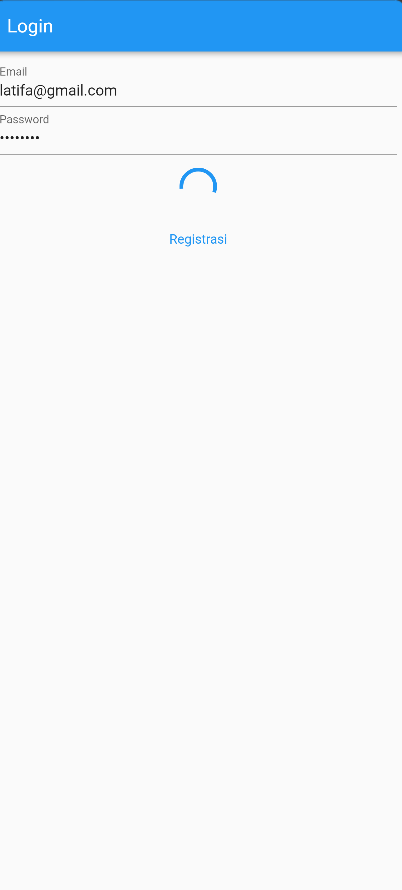 | 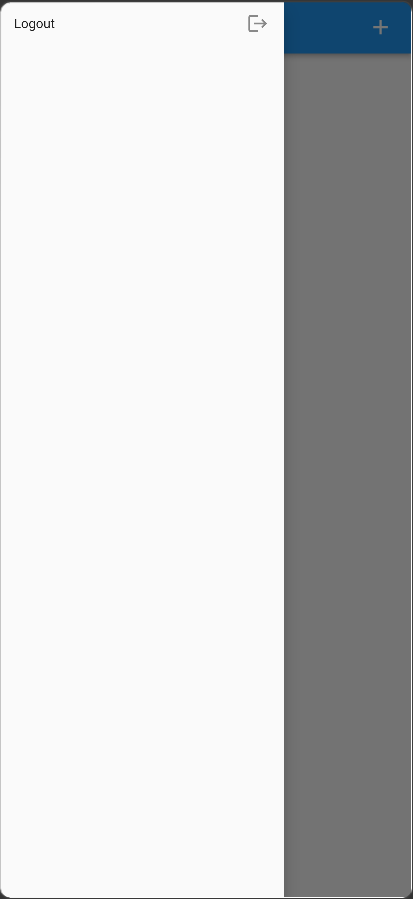 |

#### 3. Read Data Produk (List Produk Real-Time)
Halaman `ProdukPage` mengambil data produk dari database MySQL via `ProdukBloc.getProduks()`. Jika belum ada data, tampil pesan *"Tidak ada data produk"*. Saat data tersedia, produk ditampilkan dalam bentuk `Card` berisi nama dan harga.

| List Produk Awal (Kosong) | List Produk Terisi |
| :---: | :---: |
| 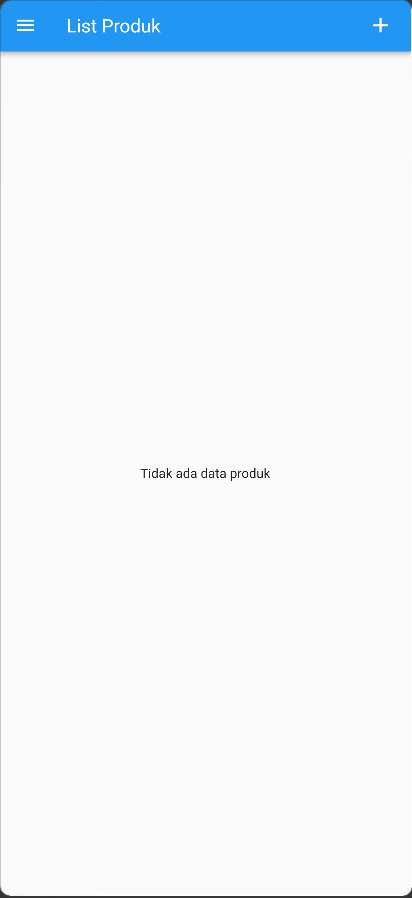 | 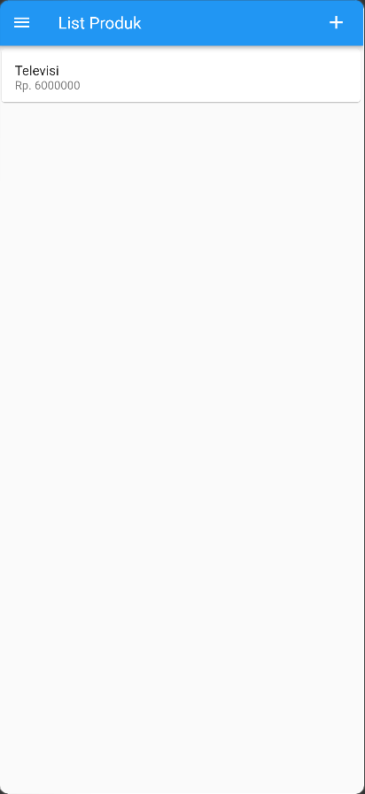 |

#### 4. Create Data (Tambah Produk)
Ikon **`+`** pada AppBar membuka `ProdukForm`. Pengguna memasukkan `Kode Produk`, `Nama Produk`, dan `Harga`. Menekan tombol **SIMPAN** akan mengirim data via `POST /produk`, menampilkan dialog sukses, dan me-refresh daftar produk.

| Form Tambah Produk | Dialog Tambah Sukses |
| :---: | :---: |
| 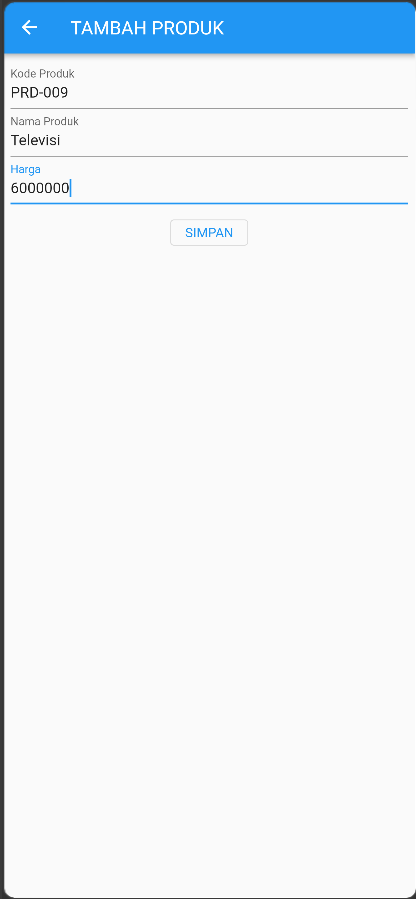 | 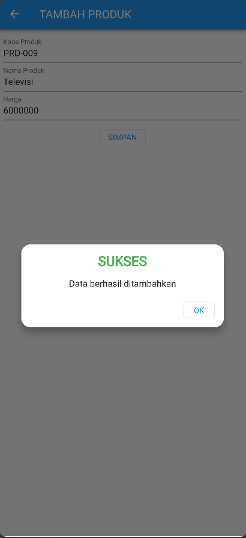 |

#### 5. Detail & Update Data (Ubah Produk)
Mengklik salah satu kartu produk akan membuka halaman `ProdukDetail`. Menekan tombol **EDIT** membuka form dalam mode ubah (`UBAH PRODUK`). Data yang diubah disimpan ke API via `PUT /produk/{id}` dan memunculkan konfirmasi dialog sukses.

| Detail Produk Awal | Dialog Ubah Sukses | Detail Produk Terupdate |
| :---: | :---: | :---: |
|  | 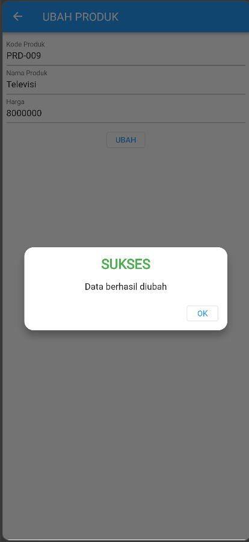 |  |

#### 6. Delete Data (Hapus Produk)
Pada halaman detail, menekan tombol **DELETE** memunculkan konfirmasi dialog *"Yakin ingin menghapus data ini?"*. Jika tombol **Ya** ditekan, data dihapus via `DELETE /produk/{id}` dan kembali ke daftar produk.

| Dialog Konfirmasi Hapus | List Produk Setelah Dihapus |
| :---: | :---: |
|  |  |

---

### Struktur Folder Proyek

```text
flutter1/
├── lib/
│   ├── bloc/
│   │   ├── login_bloc.dart
│   │   ├── logout_bloc.dart
│   │   ├── produk_bloc.dart
│   │   └── registrasi_bloc.dart
│   ├── helpers/
│   │   ├── api.dart
│   │   ├── api_url.dart
│   │   ├── app_exception.dart
│   │   └── user_info.dart
│   ├── model/
│   │   ├── login.dart
│   │   ├── produk.dart
│   │   └── registrasi.dart
│   ├── ui/
│   │   ├── login_page.dart
│   │   ├── produk_detail.dart
│   │   ├── produk_form.dart
│   │   ├── produk_page.dart
│   │   └── registrasi_page.dart
│   ├── widget/
│   │   ├── success_dialog.dart
│   │   └── warning_dialog.dart
│   ├── about_page.dart
│   ├── column_widget.dart
│   ├── hello_world.dart
│   ├── home_page.dart
│   ├── login_page.dart
│   ├── main.dart
│   ├── row_widget.dart
│   └── sidemenu.dart
├── ss/
│   ├── 4detail.png
│   ├── 4detailbaru.png
│   ├── 4hapus.png
│   ├── 4konfirhapus.png
│   ├── 4list.png
│   ├── 4login2.png
│   ├── 4produk.png
│   ├── 4regist.png
│   ├── 4registsukses.png
│   ├── 4side.png
│   ├── 4tambah.png
│   ├── 4tambahsukses.png
│   ├── 4ubahsukses.png
│   ├── column.png
│   ├── dataproduk.png
│   ├── detail.png
│   ├── formproduk.png
│   ├── hello.png
│   ├── homepage.png
│   ├── login.png
│   ├── row.png
│   └── sidemenu.png
└── pubspec.yaml
```

---

## Cara Menjalankan Aplikasi

1. **Jalankan Server Backend**:
   - Pastikan Laragon / XAMPP berjalan (Apache & MySQL aktif).
   - Backend `toko-api` aktif pada port 80.
2. **Pasang Dependensi**:
   ```bash
   flutter pub get
   ```
3. **Jalankan Aplikasi**:
   - Browser Google Chrome:
     ```bash
     flutter run -d chrome
     ```
   - Android Emulator / Device Fisik:
     ```bash
     flutter run
     ```

## Pengujian & Verifikasi Kode

Jalankan pengujian statis dan pengujian otomatis:
```bash
flutter analyze
flutter test
```
*Hasil analisis: `No issues found!`, semua unit test model parsing dan widget test lulus 100%.*
